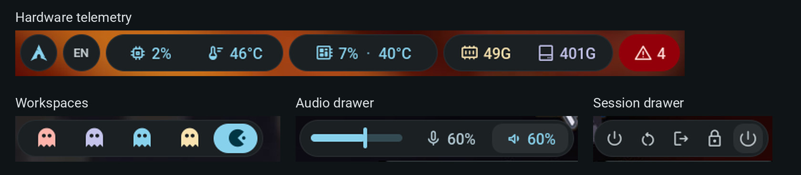
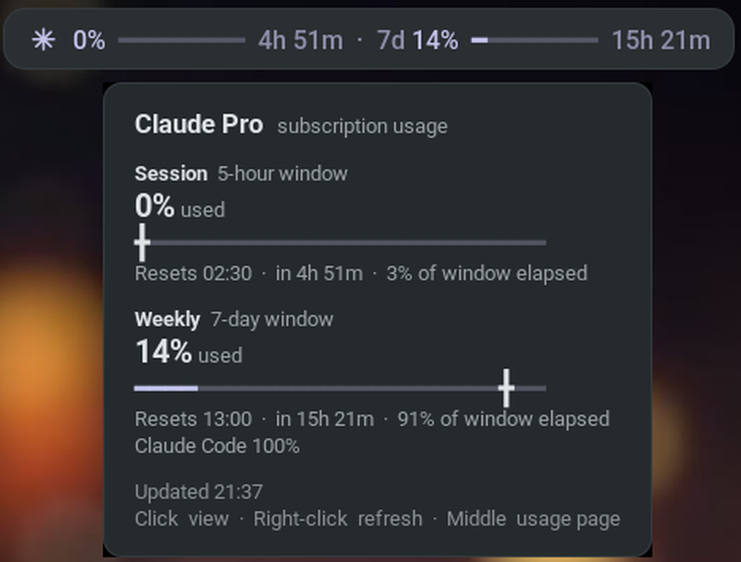
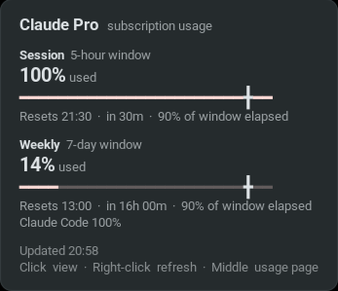

# Athena — Material You Waybar for niri

Material You bar for niri. Every colour is a role from the matugen palette, so the
bar follows the wallpaper; nothing is hand-tinted except the two threshold
literals (`state_ok`, `state_warn`) that M3 has no role for.

Modular JSONC configuration, GTK3 CSS tokens, hardware telemetry, audio and
session drawers, Pac-Man workspaces, and a standalone Claude Code usage monitor.
Tested with **Waybar 0.15.0**, **GTK 3.24**, and **Python 3.11+** on Linux.

## Screenshots




Captured from the running bar. The detail view combines screenshot crops.
[View the full-resolution bar](docs/screenshots/bar.png).

## Install

Install [Waybar](https://github.com/Alexays/Waybar),
[niri](https://github.com/YaLTeR/niri), Python 3.11+, and the fonts listed below.
Back up an existing configuration before cloning:

```sh
if [ -e "$HOME/.config/waybar" ]; then
  mv "$HOME/.config/waybar" "$HOME/.config/waybar.backup-$(date +%Y%m%d-%H%M%S)"
fi
mkdir -p "$HOME/.config"
git clone https://github.com/Hoxiee/waybar-athena.git "$HOME/.config/waybar"
```

The module commands expect this installation path. Start the bar inside your
niri session:

```sh
waybar -c "$HOME/.config/waybar/config.jsonc" -s "$HOME/.config/waybar/style.css"
```

For automatic startup, add `spawn-at-startup "waybar"` to your niri config,
or enable your existing Waybar user service.

### Adapt to your machine

| File | Setting |
| --- | --- |
| `modules/compute.jsonc` | CPU temperature paths and thresholds; supplied values target AMD k10temp / Ryzen 7000 |
| `modules/status.jsonc` | Change `network.interface` (`wlp7s0`), or remove it to follow the default route |
| `modules/clock.jsonc` | Change `clock.timezone` (`Europe/Moscow`), or remove it to use local time |
| `modules/launcher.jsonc` | Launcher command and distro icon |
| `modules/language.jsonc` | EN/RU labels; configure your actual layouts in niri |
| `modules/compute.jsonc`, `modules/gpu.jsonc`, `modules/storage.jsonc`, `modules/health.jsonc` | Replace `alacritty` if you use another terminal |

Find CPU sensors with `sensors` and inspect `/sys/class/hwmon/*/name` and
`temp*_label`. Prefer a stable device path over a numbered `hwmonN` directory.
The NVIDIA and push-to-talk scripts emit nothing when their tools are absent.
Remove unwanted modules from the `modules-*` arrays or `modules/groups.jsonc`.

You can keep overrides out of Git in an ignored `config.local.jsonc`:

```jsonc
{
  "include": ["./config.jsonc"],
  "clock": { "timezone": "Europe/Berlin" },
  "network": { "interface": "wlan0" }
}
```

Launch with `-c "$HOME/.config/waybar/config.local.jsonc"` to use it. Waybar
merges included objects; values in the including file take precedence.

## Look

- **Tonal islands.** Flat 39px `surface_container` pills with a 7% hairline, no
  shadows. Text pills inset 15px; icon pills are exact circles.
- **Type.** Roboto Medium 16px with tabular figures; icons are Material Symbols
  Rounded at 21px, shifted down 4pt so they centre on the digits. The span is the
  same in every module, so size and baseline are one search-and-replace away.
- **Two kinds of island.** Tonal text on a surface (readouts) and filled chips
  (clock, media, active workspace, RU layout, idle/PTT when on).
- **State layers.** Hover blends 8% of the content colour in, press 12%. Single
  pills react as a whole; inside a group each child has its own 31px state layer.
- **Motion.** M3 emphasized easing `cubic-bezier(0.2, 0, 0, 1)`. Pills morph from
  full pill → 14px (hover) → 10px (press); workspace capsules keep one size and shape;
  only live hardware criticals pulse.
- **Workspaces.** Pac-Man on a primary capsule for the focused one; the ghosts are
  Blinky / Pinky / Inky / Clyde mapped to `error` / `tertiary` / `primary` /
  `state_warn`, and fade when the workspace is empty.

## Claude monitor

`scripts/claude-usage.py` is a long-lived process that reads the same endpoint as
Claude Code's `/usage`, with the token Claude Code keeps in
`~/.claude/.credentials.json` (or `$CLAUDE_CONFIG_DIR/.credentials.json`). Sign
into Claude Code with your subscription first. It fetches every 3 minutes and
re-renders the countdown each minute without the network. This is a community
integration with Claude's OAuth usage endpoint; its response format may change.

- Face: session %, a progress line, time to reset. The weekly cap joins once
  it passes 50%. Click toggles the full view (both windows).
- Amber past 75% or when the last hour's burn rate would exhaust the session
  before the reset; red past 90%; an exhausted window becomes an error chip
  with the time it comes back.
- Tooltip: both windows with an elapsed-time marker on the bar, the projected
  limit time, the weekly breakdown (Claude Code / Chats / …), extra usage.
- Notifications at 80% and 95% of each window, once per window, and when the
  session limit lifts.
- Right-click forces a fetch; middle-click opens claude.ai/settings/usage.
- It never refreshes the OAuth token — refresh tokens rotate, and spending one
  would log the running Claude Code out. On expiry the pill dims until Claude
  Code renews it.
- Colours come from `tokens/colors.css` at render time, so the meter follows
  matugen. State lives in `$XDG_RUNTIME_DIR/claude-usage/`, falling back to
  `/tmp/claude-usage-<uid>/`. The directory is private (0700) and newly written
  files are owner-only. Credentials are read locally and never cached or printed.
- `Retry-After` is respected on HTTP 429, including manual refreshes.

| After reset · expanded view | Session limit reached |
| --- | --- |
|  |  |

The script uses only the Python standard library. Run it directly to inspect
its newline-delimited Waybar JSON output, or use `--help`, `--toggle`,
`--refresh`, and `--open`. Controls address the most recently started monitor
for the current user/session.

## Wallpaper colours

The checked-in `tokens/colors.css` is a complete dark palette; matugen is
optional. To generate colours from your own wallpaper, install
[matugen](https://github.com/InioX/matugen) and add this section to
`~/.config/matugen/config.toml`:

```toml
[templates.waybar-athena]
input_path = '~/.config/waybar/templates/colors.css'
output_path = '~/.config/waybar/tokens/colors.css'
```

Then run `matugen image /path/to/wallpaper`. The bar reloads imported CSS
automatically; the Claude meter picks up the palette on its next render.
The calendar tooltip uses literal Pango colours in `modules/clock.jsonc`;
update those if you want them to match a substantially different palette.

## Optional New API integration

The six `custom/newapi-*` slots use a portable adapter in `scripts/newapi.sh`.
They stay hidden until you connect an external New API monitor that accepts a
slot number and writes Waybar JSON. Either export `NEWAPI_WAYBAR_SCRIPT` to
the adapter's executable path in Waybar's environment, or create a local link:

```sh
ln -s /path/to/newapi-monitor/waybar/newapi.sh "$HOME/.config/waybar/scripts/newapi.local.sh"
```

`scripts/*.local.sh` is ignored by Git. Keep provider credentials, account
registries, and caches in the external monitor's own configuration directory.
This repository contains no provider keys or account data.

## Structure

```
waybar/
├── config.jsonc        entry point: bar geometry, module order, includes
├── style.css           imports the token files in dependency order
├── modules/            one jsonc per feature (formats, clicks, thresholds)
├── scripts/            gpu.sh, ptt.sh, claude-usage.py,
│                       newapi.sh (optional external-monitor adapter)
├── templates/          matugen template for tokens/colors.css
├── tests/              offline Claude monitor checks
├── docs/screenshots/   desktop, module close-ups, and Claude tooltip
└── tokens/
    ├── colors.css      included palette; optionally regenerated by matugen
    ├── base.css        warn/ok literals, reset, type, tooltip
    ├── capsule.css     island shape, state layers, inner items, anti-jitter widths
    ├── accent.css      resting colour of each module
    ├── state.css       thresholds, off states, pulse animations
    ├── workspace.css   centre island contents
    └── slider.css      volume slider in the audio drawer
```

## Adding a module

1. Declare it in `modules/*.jsonc` and list it in `config.jsonc` (`include` and
   one of `modules-*`). Icons: `<span font='Material Symbols Rounded 21px'
   rise='-4pt'>NAME</span>`, where NAME is the ligature from
   fonts.google.com/icons; `@FILL=1` after `21px` gives the filled form.
2. Add its `#id` to the pill lists in `tokens/capsule.css` (base, `:hover`,
   `:active`) — or, if it lives in a group, to the inner-items lists.
3. Give it a resting colour in `tokens/accent.css` and thresholds in
   `tokens/state.css`.

## Dependencies

| Package | Purpose |
| --- | --- |
| waybar, niri | Bar and compositor (niri-specific workspace/layout modules) |
| ttf-roboto | Text |
| [Material Symbols Rounded](https://github.com/google/material-design-icons/tree/master/variablefont) (variable) | Icons |
| JetBrains Mono / JetBrainsMono Nerd Font | Progress lines, Arch logo, Pac-Man glyphs |
| python 3.11+ | Claude monitor (stdlib only) |
| swaync | Notification centre |
| nm-applet / blueman | Network and Bluetooth |
| pipewire (wpctl) / pavucontrol | Audio |
| vicinae | Launcher (distro button) |
| [yaptt](https://github.com/Hoxiee/yaptt), jq | Push-to-talk indicator |
| nvidia-smi / nvtop | GPU readout |
| alacritty, htop | Terminal hardware/service views |
| swaylock, wlogout | Lock screen and session menu |
| notify-send, xdg-open | Claude notifications and usage-page link |

Dependencies for optional modules are only needed if you use those modules.
Use a Waybar build with MPRIS, PulseAudio, Bluetooth, and systemd support for
the full configuration.

## Validation

```sh
python3 scripts/check-config.py
python3 -m unittest discover -s tests -v
```

The checker parses every JSONC file, verifies includes, module references,
script paths, CSS imports/colour roles, Python syntax, and shell syntax. To
also check the stylesheet with GTK3, install Python GObject/GTK3 bindings and
run `python3 scripts/check-config.py --gtk` inside a graphical session (or
`xvfb-run -a python3 scripts/check-config.py --gtk`). GitHub Actions runs both
configuration and offline monitor checks on each push and pull request.

## Notes

- Colour and CSS edits apply live (`reload_style_on_change`); changes to
  `config.jsonc` or `modules/*.jsonc` need a Waybar restart. If you use a user
  service, run `systemctl --user restart waybar`.
- The Claude monitor currently reads Linux file-based Claude Code credentials.
  API-key-only logins do not supply subscription usage for this module.

## License

[MIT](LICENSE). Fonts and external programs retain their own licenses.
